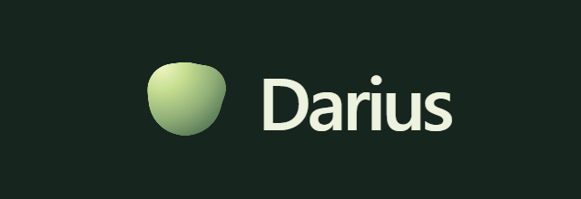
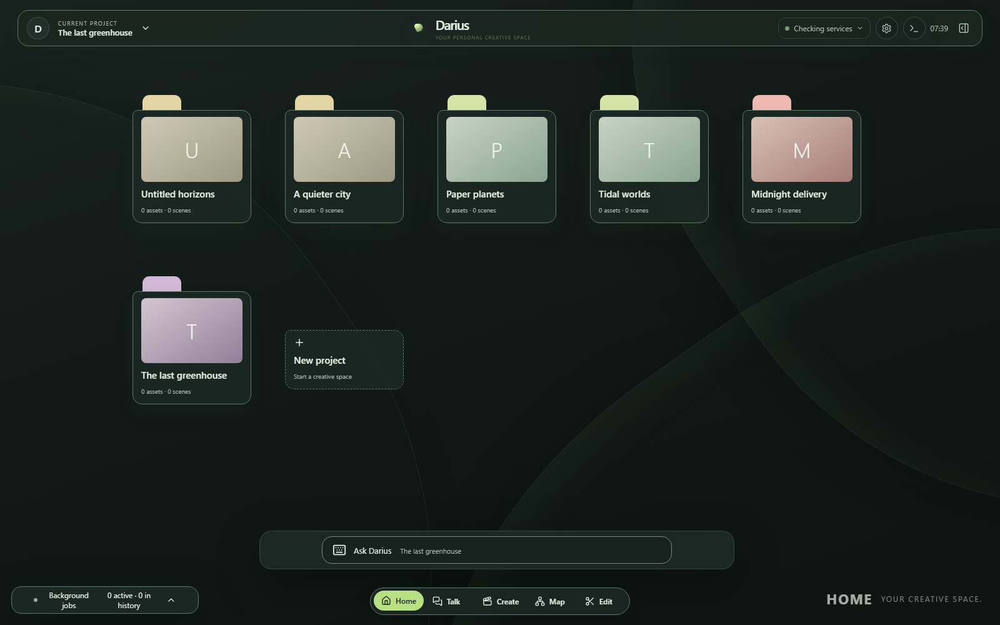
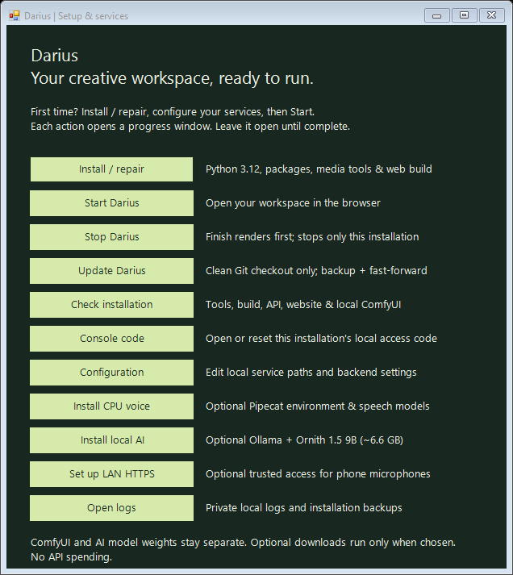
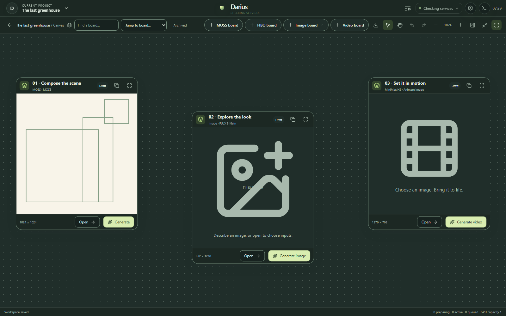
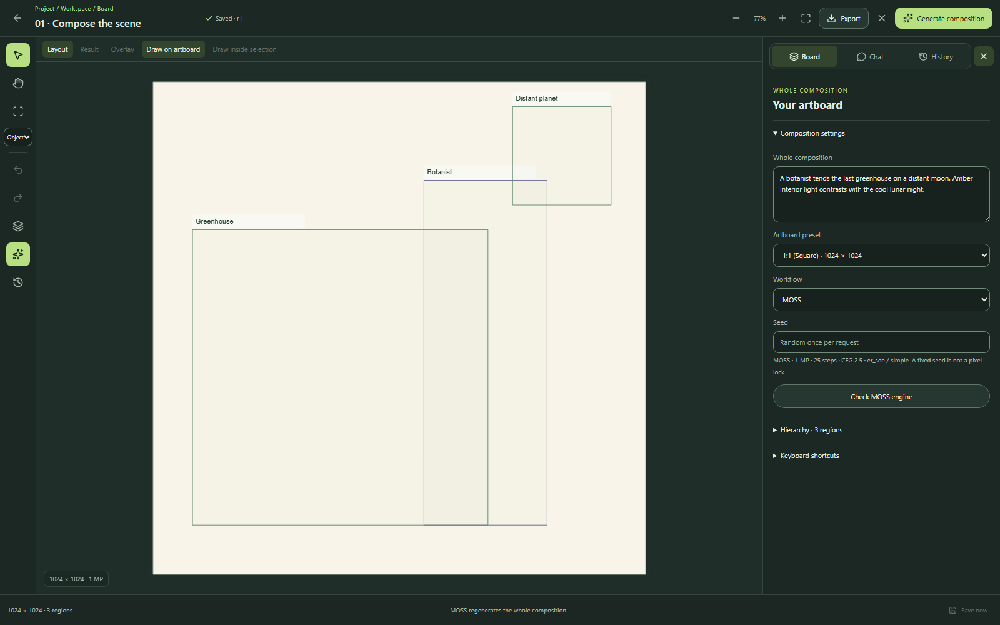
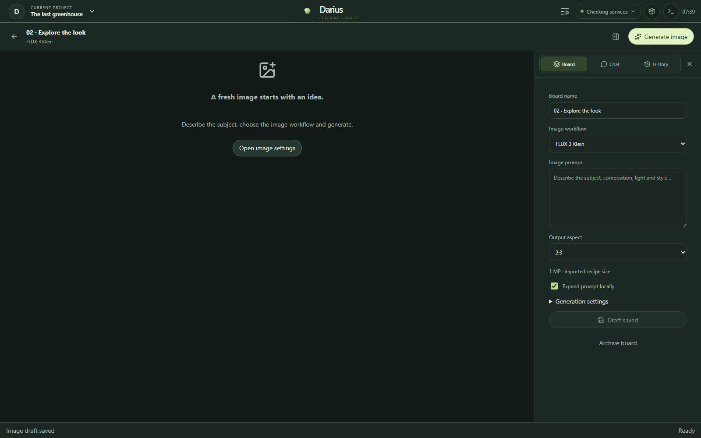
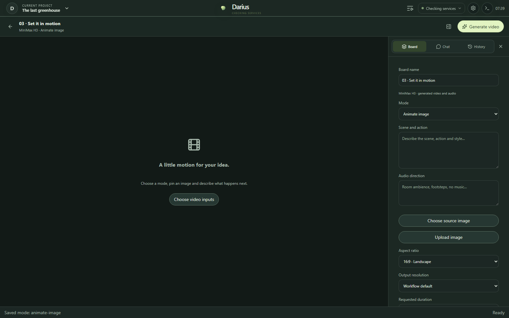
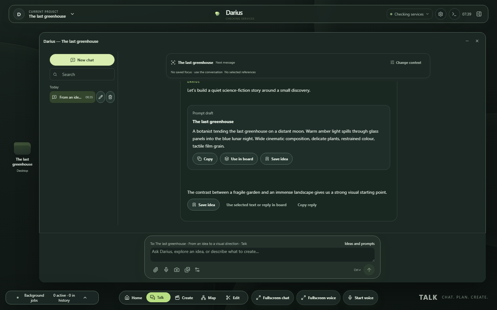
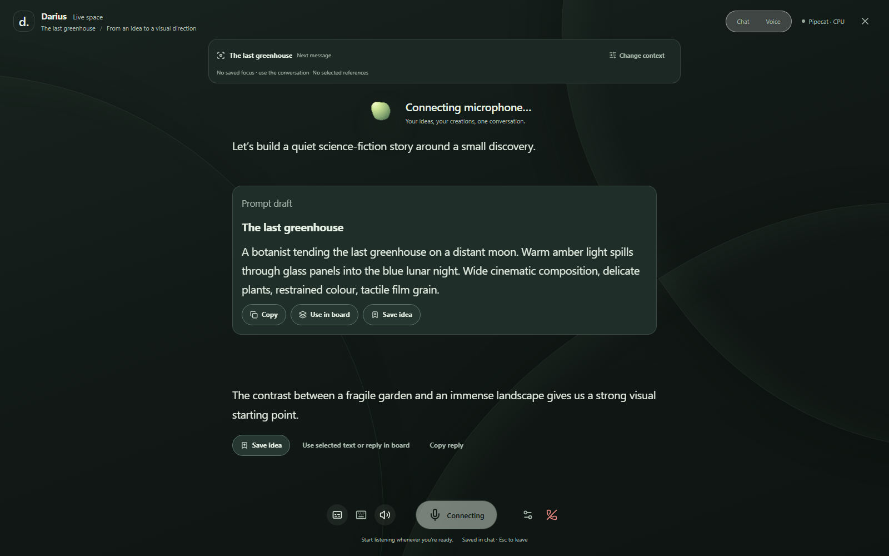

# Darius

<p align="center"></p>

Darius is a local-first creative workspace for conversation, voice, images, video and story production. The current release is an early-access Windows/PowerShell application with a FastAPI/SQLite backend, Next.js interface and separate execution workers.



## What is available

- **Talk and fullscreen voice:** project conversations, live transcription, local voice commands, asset viewing and spoken replies.
- **Creative helper:** develop ideas and prompt drafts in chat, then use **Use in board** to review and apply text to a chosen board. Rendering starts with that board's **Generate** control; chat never launches workflows.
- **Saved ideas:** open Fullscreen chat for a text-first discussion, then use **Save idea** to keep a reviewed concept under **Create → Ideas**, with search, copy, archive and restore.
- **Canvas:** independently movable MOSS/FIBO composition boards, image-generation/edit boards and MiniMax H3 video boards. Drafts, pinned input versions and labeled generation history remain with each board.
- **Image boards:** FLUX 3 Klein, Krea 2 Turbo, Qwen Image 2.1 text-to-image and multi-reference editing, using registered workflow templates.
- **Video boards:** Animate image, Camera direction and Reference video modes, with generated audio and related stage artifacts.
- **Production and Edit:** scenes, shots, project assets, timeline editing and worker-backed media exports.
- **Connected devices:** project synchronization, responsive layouts, optional trusted LAN HTTPS and a diagnostic console.

Local model options are Ollama and llama.cpp. OpenAI, DeepSeek, OpenCode and BFL integrations are optional; available models and capabilities depend on their provider and configuration. Settings can refresh supported model catalogs. Cloud credentials stay on the backend.

## Requirements

- Windows 11 / PowerShell for the tested launchers.
- Python 3.12 and [uv](https://docs.astral.sh/uv/) 0.11.19 or newer (the Windows manager handles a missing/older uv).
- Node.js compatible with Next.js (minimum 20.9) and npm.
- FFmpeg and ffprobe on PATH, or explicit paths in `.env`.
- For local generation: a running ComfyUI installation, the Comfy MCP CLI and the nodes/models required by the selected workflow.

Voice engines and model weights are installed separately. They are not bundled in this repository. This is a trusted workstation/LAN application; project IDs are not a multi-user authentication system, and direct public Internet hosting is not the supported deployment.

Darius's original application code is licensed under [0BSD](LICENSE), permitting
commercial use, modification and redistribution. Third-party workflows, model
weights, runtimes and dependencies retain their own terms; see
[attributions and third-party notices](THIRD_PARTY_NOTICES.md).

## Install



On Windows, double-click **install.bat** to open the Darius manager. Choose
**Install / repair**, configure your services, then **Start Darius**. The manager
handles missing Windows tools, Python 3.12, locked packages, migrations and the
web build. **Darius.bat** opens the same window for startup, diagnostics, updates,
optional CPU voice and LAN HTTPS. Existing settings and projects are preserved.
See the [Windows manager guide](docs/windows-manager.md) for prerequisites,
backups, update restrictions and separately managed ComfyUI/models.

For local chat, choose **Install local AI** in the manager after the main
installation. It installs missing Ollama, downloads **Ornith 1.5 9B Q4_K_M**
(approximately 6.6 GB), and verifies the model's text, tools and vision metadata.
Existing Ollama/model installations are reused. Setup then offers to select it
for chat; declining keeps your current provider. This optional action is separate
from board models and does not run an inference or load a model onto the GPU.
See [local AI setup](docs/ollama-setup.md) for hardware guidance and manual steps.

Manual setup from the checkout root:

```powershell
uv sync --frozen --extra test
Copy-Item .env.example .env
npm ci --prefix apps/web
Copy-Item apps/web/.env.example apps/web/.env.local
.\.venv\Scripts\python.exe -m alembic upgrade head
```

Edit `.env` to point at your own ComfyUI output folder and Comfy MCP executable. Configure a downloaded local conversational model or optional cloud credentials, then select the provider in **Settings → AI model**. Do not copy another computer's credentials or runtime database.

The web app normally uses a same-origin proxy; browser-side provider keys are unnecessary. `.env.example` contains placeholders and can be committed; your `.env` and `.env.local` cannot.

## Start

```powershell
.\start-darius.bat check
.\start-darius.bat
```

The launcher applies migrations, builds the web app, starts the API/web services and opens **http://127.0.0.1:3000**. API documentation is at **http://127.0.0.1:8000/docs**. Installed optional voice services are detected automatically. Logs and process information are written under ignored `data/`.

Normal startup does not launch a persistent general worker. Explicit Canvas Generate actions can start execution workers on demand. Chat develops ideas and prompt text; it does not submit render jobs. To drain other approved queued work continuously:

```powershell
.\start-darius.bat worker
```

For frontend/API development, use `scripts/start-local.ps1 -Development`. The launcher restarts services belonging to this checkout, so do not use it during an active generation.

## Canvas and workflows

Open **Create → Canvas**. The toolbar adds MOSS, FIBO, Image and Video boards. The Image board menu chooses one of the four image recipes. Each workflow keeps its own editable draft; switching, saving or uploading does not generate. Wheel zooms, holding the middle mouse button pans, and Fit restores the view.



<p></p>

Qwen Edit accepts explicitly selected/uploaded project images. Their content versions are pinned; selecting a newer upstream image is a separate action. Generated results remain in History. MOSS/FIBO region layouts and plain image/video recipe inputs are distinct capabilities.

- [MOSS](docs/canvas-moss.md), [FIBO](docs/canvas-fibo.md), [multi-board workspace](docs/multi-board-workspace.md)
- [Image generation/edit recipes](docs/canvas-image-recipes.md)
- [MiniMax H3 video recipes and current limits](docs/canvas-minimax-h3.md)
- [Trusted workflows](docs/trusted-workflows.md) and [Block Party import](docs/block-party-integration.md)
- [Creative chat and prompt transfer](docs/creative-helper.md)
- [First-use board model/node preparation](docs/board-first-use-setup.md)

Original workflow sources and versioned templates are under `workflows/defaults/` and `workflows/canvas/`. Do not edit hash-pinned templates in place: create a new adapter/version. Per-job contracts and graphs under `workflows/definitions/` contain local project data and stay out of Git; only reviewed static examples are included.

Legacy Krea/seamless semantic contracts remain for compatibility. They are unavailable when their original external source files are absent. Canvas recipes use the bundled versioned templates instead.

## Voice, LAN and other guides





- [Pipecat voice](docs/pipecat-voice.md) and [classic local voice](docs/local-voice.md)
- [Fullscreen conversation](docs/fullscreen-voice.md) and [local command router](docs/local-command-router.md)
- [Trusted LAN microphones / HTTPS](docs/lan-https.md) and [device sync](docs/device-sync.md)
- [Model catalogs](docs/model-catalogs.md), [Ollama profiles](docs/ollama-runtime.md), [BFL](docs/bfl-cloud.md)
- [Timeline editing](docs/edit-modernization.md), [diagnostic console](docs/local-console.md), [job recovery](docs/local-job-recovery.md)

To use the optional R2T2 fallback, initialize its pinned source first:

```powershell
git submodule update --init vendor/Confucius4-R2T2
```

Follow the voice guide for its separate runtime. The normal CPU transcription path does not require this submodule. Optional model weights, voice runtimes and external tools retain their own licenses.

## Validate changes

```powershell
.\.venv\Scripts\python.exe -m pytest
.\.venv\Scripts\python.exe scripts/export_openapi.py --check
.\.venv\Scripts\python.exe scripts/release_audit.py --history --privacy
npm run lint --prefix apps/web
npm run typecheck --prefix apps/web
npm test --prefix apps/web
npm run build --prefix apps/web
```

After API/schema changes, regenerate `docs/openapi/darius-api.json` with `scripts/export_openapi.py`. The normal automated suites use temporary projects and fake generation/AI providers; they do not authorize paid model calls or real GPU renders. Local session-specific browser/GPU acceptance probes and evidence remain ignored.

## Repository boundaries

Commit application source, tests, migrations, lockfiles, documentation and reviewed workflow templates. Keep databases, media, model weights, credentials, personal certificates, local demo/design workspaces and generated job graphs on the workstation. `.gitignore` documents these boundaries.

See [release preparation](docs/releasing.md) for clean-checkout checks, model/template licensing considerations and publication steps. The owner selected [0BSD](LICENSE) for original Darius code; third-party components retain their own terms.
